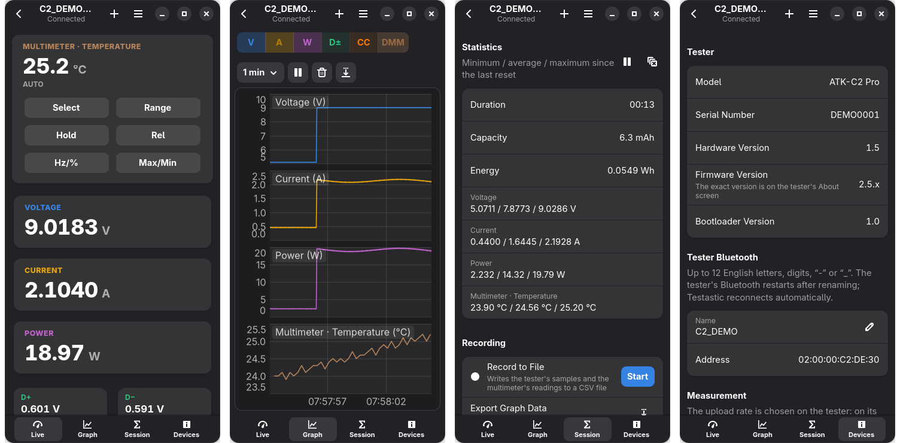
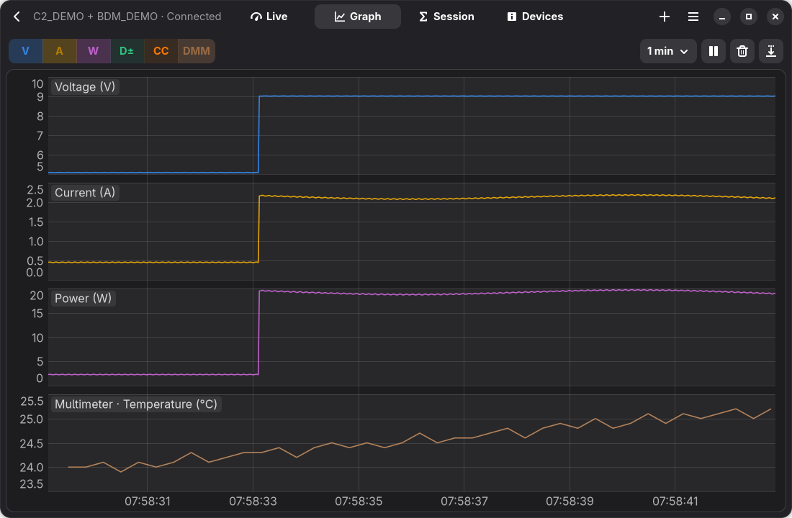

# Křižík

A GTK 4 / libadwaita app for the **ALIENTEK C2 USB tester** (C2 Std and C2 Pro)
and **OWON Bluetooth multimeters** (B35T+, B41T+ and related models) over
Bluetooth LE. It also reads several **USB testers over a USB cable**: the
ALIENTEK C0, C2 and UT70, and the FNIRSI FNB58, FNB-C2, FNB48S, FNB48 and C1.
A tester and a multimeter can be connected at the same time and share the
graph and the recording. It adapts to GNOME on the desktop and to
Linux phones (Phosh, GNOME Mobile, Plasma Mobile).

The app is named after František Křižík (1847–1941), the Czech electrical
engineer who invented the self-regulating arc lamp and built Prague's first
electric tram line. Its command and files use the spelling `krizik`.





## Features

- Finds nearby testers, remembers the last one and reconnects automatically
  (also after the tester was out of range or switched off)
- Live voltage, current and power, D+/D−, CC1/CC2, load resistance and tester temperature
- Fast-charging protocol, gear and requested voltage as detected by the tester
- Real-time graph with separate lanes for V, A, W, D± and CC, a selectable time
  span, pause, and a cursor (hover, or drag a finger) that shows exact values
- Capacity (mAh) and energy (Wh) counting, min/average/max statistics
- Alarms for over/under-voltage, over-current and over-power (toast, sound, notification)
- Automatic stop: stop counting when the current stays low (charging finished),
  or after a time, capacity or energy limit
- Recording every sample to CSV, and exporting the graph history
- Renaming the tester's Bluetooth name
- Firmware updates over USB (from ALIENTEK's `.atk` files)
- An OWON multimeter alongside the tester (see below)
- USB testers over a USB cable (see below)
- Keeps the screen on while connected (optional), which matters on phones

### What the C2 supports over Bluetooth

The tester's firmware accepts only six Bluetooth commands: identify, device info,
realtime data, start, and get/set name (see [PROTOCOL.md](PROTOCOL.md)). Triggering
fast-charging protocols, changing the upload rate, the language and reading offline
records are **only available over the tester's USB port**, so Křižík can't do
them over Bluetooth. The upload rate is changed on the tester itself (▶ button on
the basic measurement screen); Křižík follows it automatically.

### OWON multimeters

Křižík supports the meters that work with OWON's "Multimeter BLE" and
"iMeter" apps, including rebrands of them. It was written for the B35T+ and
B41T+; the OW18 and other families use the same protocol, but are untested.
The protocol is described in [METER_PROTOCOL.md](METER_PROTOCOL.md).

- The reading as on the meter's display: function, range, OL, and the AUTO,
  HOLD, REL, MIN/MAX and low-battery indicators
- The meter's buttons (Select, Range, Hold, Rel, Hz/%, Max/Min) from the app;
  press and hold for a long press
- The reading as a lane in the graph, on the same time axis as the tester
- Minimum, average and maximum per function
- Readings in the same CSV recording as the tester's samples: one row per
  tester sample with the newest meter reading beside it, and rows of their own
  while no tester data arrives
- Battery level, firmware version and renaming
- Offline recording: start a recording on the meter (interval and number of
  readings), stop it, and download the readings as CSV. The meter switches
  Bluetooth off while it records, so Křižík disconnects from it; connect
  again when the recording has finished.

### USB testers

These testers are read over their USB data port and appear in the device list
as soon as they are plugged in:

| Tester | Measures |
|---|---|
| ALIENTEK C0, C2 (PC port) | V, A, W, D±, CC1/CC2, PD monitor; 2–1000 samples/s as set on the tester |
| ALIENTEK UT70 (Micro-USB HID port) | V, A, W, D±; 4–1000 samples/s |
| FNIRSI FNB58, FNB-C2, FNB48S, FNB48, C1 | V, A, W, D±, temperature; 100 samples/s |

The protocols are described in [USB_PROTOCOLS.md](USB_PROTOCOLS.md). They were
read from the vendors' software, not tested with every tester; reports are
welcome. Install the udev rule (see *Updating the tester's firmware*) so that
Křižík may open them. Not supported: the ALIENTEK OA1 cable tester (its PC
protocol has no measurement readout) and the FNIRSI FNB38 and FNAC28 (no known
protocol).

## Using it

1. On the tester, enable Bluetooth: **Settings → Others → Bluetooth**. On the
   multimeter, switch Bluetooth on (the Bluetooth symbol appears on its display).
2. Start Křižík and choose the device from the list.
3. To use a second device, press **+** in the header bar. Křižík connects to
   one tester and one multimeter at a time; choosing another device of the
   same kind replaces the first.

Křižík remembers both devices and reconnects to them when it starts. The
back button disconnects everything and keeps both for the next start.
Disconnecting one of two devices on the Devices page also forgets that device.

`krizik --demo` runs with a simulated tester and multimeter, if you want to
look around without hardware (`KRIZIK_DEMO=tester` or `meter` for only one,
`usb` for a simulated USB tester with the multimeter).

## Updating the tester's firmware

Firmware can only be updated over USB, not Bluetooth.

1. Install the udev rule once, so Křižík may use the tester over USB
   (needed for the Flatpak too, and for all USB testers):
   ```sh
   sudo install -Dm644 data/udev/70-krizik.rules /etc/udev/rules.d/70-krizik.rules
   sudo udevadm control --reload && sudo udevadm trigger --subsystem-match=usb
   ```
2. Connect the tester's PC port (the USB-C port opposite the buttons) with a data
   cable; on a phone, use a USB-C OTG adapter or cable.
3. Open **Main Menu → Update Tester Firmware…**, choose an `.atk` file from ALIENTEK's
   firmware package (unzip it first) and press **Install**.

Křižík shows the exact installed version (Bluetooth only reports e.g.
2.4.x), checks that the file matches the tester, restarts the tester into update
mode, writes the firmware and reads the new version back. If an update is
interrupted, hold the tester's return button while connecting it to enter update
mode, then install again.

From a terminal:

```sh
krizik --usb-info                        # model, serial and exact firmware version
krizik --firmware-check  C2_APP_V2.5.0.atk   # everything except writing
krizik --firmware-install C2_APP_V2.5.0.atk
```

## Building

Requirements: Rust 1.92 or newer, GTK ≥ 4.12, libadwaita ≥ 1.5, BlueZ and the
D-Bus development files. If your distribution's Rust is older (check with
`rustc --version`; Debian stable and Ubuntu LTS releases usually are), install a
current one with [rustup](https://rustup.rs) and leave `cargo` out of the
packages below.

| Distribution            | Packages |
|-------------------------|----------|
| Fedora                  | `sudo dnf install cargo gtk4-devel libadwaita-devel dbus-devel` |
| Debian, Mobian, Ubuntu  | `sudo apt install cargo libgtk-4-dev libadwaita-1-dev libdbus-1-dev pkg-config` |
| postmarketOS, Alpine    | `sudo apk add cargo gtk4.0-dev libadwaita-dev dbus-dev` |
| Arch, Manjaro ARM       | `sudo pacman -S rust gtk4 libadwaita dbus` |

```sh
git clone https://github.com/multiflexi/krizik.git
cd krizik
cargo build --release        # binary in target/release/krizik
./install.sh                 # installs to ~/.local (binary, launcher, icon)
sudo PREFIX=/usr/local ./install.sh   # system-wide
```

On a phone, build directly on the device. On a PinePhone this takes a while;
`cargo build --release` on a faster aarch64 machine with the same distribution
release works too.

### Flatpak

The manifest is in `flatpak/`. It uses the GNOME 51 runtime and needs only
Bluetooth (BlueZ) access besides the display; notifications, keeping the
screen awake and saving files go through portals.

```sh
flatpak remote-add --user --if-not-exists flathub https://dl.flathub.org/repo/flathub.flatpakrepo

# build and install directly
flatpak-builder --user --install-deps-from=flathub --install --force-clean \
    flatpak/build flatpak/io.github.multiflexi.Krizik.json

# or produce a single-file bundle to copy to another machine
flatpak-builder --user --install-deps-from=flathub --force-clean --repo=flatpak/repo \
    flatpak/build flatpak/io.github.multiflexi.Krizik.json
flatpak build-bundle flatpak/repo krizik.flatpak io.github.multiflexi.Krizik \
    --runtime-repo=https://dl.flathub.org/repo/flathub.flatpakrepo
flatpak install --user krizik.flatpak
```

Phones are aarch64, so a bundle built on a PC won't run there. Either run the
commands above on the phone, or cross-build on an x86_64 PC with
`qemu-user-static` installed: add `--arch=aarch64` to both `flatpak-builder` and
`flatpak build-bundle` (slow, because the compiler runs emulated).

The build is offline, so every crate is listed in `flatpak/cargo-sources.json`.
After changing dependencies, regenerate it:

```sh
python3 flatpak/generate-cargo-sources.py Cargo.lock > flatpak/cargo-sources.json
```

## Troubleshooting

```sh
krizik --probe                         # list nearby testers and multimeters for 10 s
krizik --probe 12:34:56:78:9A:BC 10    # connect and print readings for 10 s
RUST_LOG=debug krizik                  # verbose log
RUST_LOG=krizik=trace krizik --probe ADDRESS 20   # also every raw multimeter notification
```

- **Tester or multimeter not listed**: check that Bluetooth is on in the tester's
  settings or on the meter, and that it is not connected to another phone; each
  accepts one connection at a time. Turn on *Show All Bluetooth Devices* in
  Preferences if it was renamed to something unusual.
- **Multimeter shows wrong values**: please run the trace command above while the
  meter shows a few different functions, and report the output together with
  what the display showed.
- **No Bluetooth adapter / BlueZ not running**: `systemctl status bluetooth`.

Settings live in `~/.config/krizik/settings.ini`.

## Development notes

- `src/protocol.rs` – C2 frame encoding/decoding (unit tests use frames captured
  from a real C2 Pro); `src/owon.rs` – the multimeter protocol (frames, identity
  check, commands, offline log); `src/atkc.rs`, `src/ut70.rs`, `src/fnirsi.rs` –
  USB tester protocols; `src/usb.rs` – USB discovery (hot-plug) and sessions;
  `src/ble.rs` – the device worker on a Tokio thread, one task per connected
  device (Bluetooth or USB); `src/session.rs` – time line shared by both
  devices, statistics, alarms, auto-stop; `src/export.rs` – CSV;
  `src/ui/` – the interface.
- `cargo test` runs the protocol, statistics and CSV tests.
- CI (`.github/workflows/ci.yml`) checks formatting (`cargo fmt`), clippy
  warnings, the tests, the minimum Rust version, the desktop and AppStream
  files, and that `flatpak/cargo-sources.json` matches `Cargo.lock`. On
  Dependabot's pull requests that file is regenerated automatically.
- The same checks run locally as git hooks (formatting, clippy, the Flatpak
  crate list and the metadata before each commit, the tests before each push).
  Set them up once:
  ```sh
  python3 -m venv .venv && .venv/bin/pip install pre-commit
  .venv/bin/pre-commit install
  ```
  `.venv/bin/pre-commit run --all-files` runs them by hand, and
  `.venv/bin/pre-commit autoupdate` updates the pinned hook versions.
- `KRIZIK_SIZE=360x740 KRIZIK_SCREENSHOT=out.png KRIZIK_SCREENSHOT_PAGE=graph krizik --demo`
  renders the window to a PNG and quits (pages: `live`, `graph`, `session`, `device`,
  `firmware`, `add-device`).
  Run it inside a compositor where the window is not covered, e.g.
  `mutter --headless --wayland --virtual-monitor 1400x1000 --wayland-display shot &`
  and `WAYLAND_DISPLAY=shot`.
- The application ID `io.github.multiflexi.Krizik` appears in `src/main.rs`,
  `data/` and `install.sh`; change all of them together.

Křižík is an independent project and is not affiliated with ALIENTEK, OWON or FNIRSI.
Licensed under the European Union Public Licence v1.2 (EUPL-1.2); see `LICENSE`.
